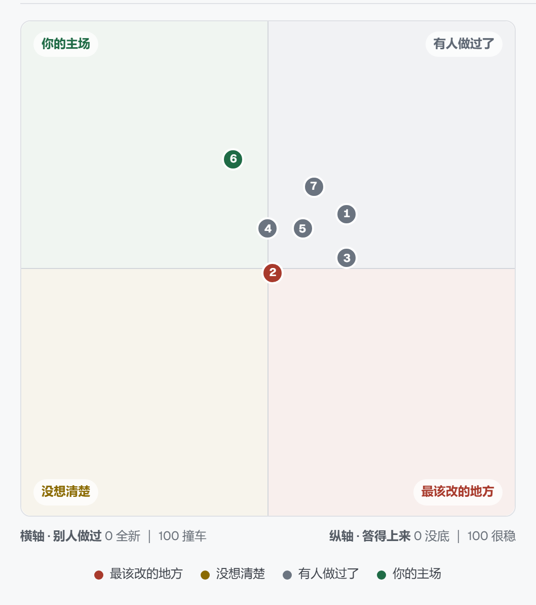

# Soft Spot

**软肋 · 论文选题诊断 · 答辩预演**

贴上论文提纲，给你一张软肋地图和一份质询清单。

[](https://creativecommons.org/licenses/by-nc-sa/4.0/)
[](https://nextjs.org/)
[](https://www.typescriptlang.org/)
[](https://nodejs.org/)
[](https://github.com/KarmaSprite/pre-defense/commits/main)
[](https://github.com/KarmaSprite/pre-defense/stargazers)

> 在你还能改的时候，告诉你哪儿会被问倒。

60 秒后拿到两份东西：

1. **软肋地图** —— 一张四象限散点图。每个点是一条主张，横轴是"这个想法别人做过吗"（越高越像），纵轴是"这条主张你答得上来吗"（越高越稳）。落在"别人做过 + 你答不上来"那个角的，就是最该改的。
2. **质询问题清单** —— 按答不上来的概率排序，每条问题带一个"为什么问这个"和一个"及格线清单"。



上面这张图是真跑出来的一份报告（测试面板第二条示例「教育学·学习分析」）：7 条主张里，第 6 条落在左上角「你的主场」，第 2 条贴着横轴中线掉进右下角「最该改的地方」，其余五条挤在中线附近。**这张图不是示意图，是页面上那块地图的原始截图。**

## 为什么做这个

开题是唯一"改了还来得及"的时刻。市面上的查重工具到答辩前才告诉你重复，那时候改不了了。

这个项目做的不是查重，是在你还能改的时候告诉你哪儿会被问倒。

## 技术栈

| 选择 | 理由 |
| --- | --- |
| Next.js 15 App Router + TypeScript | 一个进程同时管页面和 API，不需要前后端分离 |
| 不引 Tailwind，样式全写在 `app/globals.css` | 少一层构建配置就少一个能崩的地方 |
| 不引图表库，散点图手写 div 定位 | 引库要多 300KB，而这里只有十来个点 |
| DeepSeek API，直接 fetch 不用 SDK | 一次请求而已，不值得多一个依赖 |
| zod 校验每层输出 | 模型返回的 JSON 会飘，飘了要能当场抓住 |
| 不引向量库、不做 RAG | 主张只有几条到十几条，暴力比对足够，可解释性更好 |

## 架构

```
L1 抽取：提纲文本 → 主张数组（原文片段、类型、位置）
├─ L2-A 检索意图翻译：中文主张 → 英文学术检索词
└─ L2-B 质询生成：每条主张 → 1-2 个问题 + 及格线
L3 组装：纯代码，不调模型，算四象限、拼报告
```

**为什么不合成一个大 prompt**：试过。改一句话整个输出格式就崩，而且没法定位是哪一步坏的。拆开以后每层只做一件事，坏了能一眼看出是哪层。另外四象限是纯算术，让模型算它两次能给两个答案，用代码算永远一样。

## 检索为什么分三层

「这个想法别人做过吗」这一根轴，靠三个来源撑着：

| 层 | 来源 | 要 key 吗 | 状态 |
| --- | --- | --- | --- |
| 1 | arXiv、Crossref（英文学术库） | 不要 | 默认开，自动查 |
| 2 | 你自己粘的中文文献 | 不要 | 默认开，可选填 |
| 3 | DeepSeek 官方搜索（补中文网页） | 要，和模型共用 key | 可选加餐，没配就跳过 |

**为什么不接知网。** 知网没有面向个人的 API，只有机构采购；第三方转售要实名和应用场景审核。我评估过五条路，都不接：

| 方案 | 结论 |
| --- | --- |
| 官方 API | 没有个人版，不接 |
| [cnki-deepsearch](https://pypi.org/project/cnki-deepsearch/)（PyPI 上的 MCP 工具） | 实测能跑通，headless 也能过验证码。但它要在 Next 进程里起 Python 子进程 + 说 MCP 协议；一次检索 19 秒，没法像 arXiv 那样并发；靠浏览器 cookie 过验证码，别人 clone 下来第一次跑就卡住 —— 直接打掉「十分钟复现」 |
| [yanzhou/CnkiSpider](https://github.com/yanzhou/CnkiSpider) | Python 2 语法，且无 LICENSE，不能抄 |
| [itstyren/CNKI-download](https://github.com/itstyren/CNKI-download) | 已停止维护，且必须能通过校园网 IP 访问知网 |
| [cookjohn/cnki-skills](https://github.com/cookjohn/cnki-skills) | 不是代码库，是给 Claude Code 用的提示词 |

它们共同的死结是同一件事：**都是「一个人在浏览器旁边手动跑」的工具，没有一个是我们能 `fetch` 的接口。** 验证码、校园 IP、登录态，三样一个都没绕过去。

所以第 2 层留了手工粘贴 —— 你在自己电脑上搜（有校园网就有权限），把标题粘进来，一样参与打分，权重和真论文一样是 1.0。

**关于「在服务器上登录知网账号」**：走不通。知网认的是校园 IP 不是账号，个人账号没有文献库权限；而且我们只要「标题 + 作者 + 期刊 + 年份」算重合度，这些是结果页的公开信息，根本不需要权限。

## 十分钟复现

跟着走一遍，十分钟内你会得到一份真的报告（花掉大约四分钱）。

### 第 1 分钟：拿到代码

```bash
git clone https://github.com/KarmaSprite/pre-defense.git
cd pre-defense
```

### 第 2-4 分钟：装依赖

```bash
npm install
```

需要 Node.js 18.18 以上。本项目在 Node 24 上开发，没有用任何需要编译的原生依赖，装不下来多半是网络问题。

### 第 5 分钟：填 key

```bash
Copy-Item .env.example .env.local
```

然后打开 `.env.local`，把 `DEEPSEEK_API_KEY=` 后面填上你的 key（`sk-` 开头，35 个字符左右，在 <https://platform.deepseek.com/api_keys> 拿）。

**只有这一个变量是必需的。** 没配也能打开页面、能输入，点「开始诊断」时会直接告诉你缺什么，不会静默失败。

### 第 6 分钟：启动

```bash
npm run dev
```

打开 <http://localhost:3000>。终端里如果出现 `Port 3000 is in use ... using available port 3001`，说明 3000 被别的程序占了，**去看它给你的那个端口**，别盯着 3000 刷。

### 第 7 分钟：确认 key 认到了

访问 <http://localhost:3000/api/health>，应该看到：

```json
{"keyConfigured":true,"keyLength":35,"warnings":[],"model":"deepseek-chat"}
```

`keyConfigured` 是 `false` 就回上一步检查 `.env.local` 的位置和变量名（改 `.env.local` 不用重启，Next 会自己热重载）。

### 第 8-10 分钟：跑一份真提纲

把下面这段粘进输入框。这是测试面板第一条示例「教育学·学习分析」的原文（610 字，一份面向大学生的混合式教学开题）：

```
一、研究背景
混合式教学在高校课程中已广泛推开，但多数实践只报告满意度与成绩，很少追问"学生课前在平台上到底做了什么"。学习管理系统沉淀了大量行为日志，这些日志与课堂表现之间的关系尚未被充分利用。现有研究多用问卷自报的学习投入，缺少对真实行为序列的刻画。
二、研究问题
在本科教育学专业"课程与教学论"混合式课程中，学生课前在线学习的行为序列模式，能否预测其在课堂研讨环节的发言质量？
三、研究内容
1. 梳理学习分析领域中使用行为日志刻画学习投入的常用指标与分析方法。
2. 采集并编码学生课前在线学习的行为日志，识别典型行为序列模式。
3. 检验行为序列模式与课堂发言质量之间的关联。
四、研究方法
采用混合方法设计，选取本校教育学专业两个平行班共 128 名学生作为样本（实验班 64 人、对照班 64 人），持续一个学期共 16 周。行为数据来自课程学习管理平台的后台日志，共采集 128 名学生的点击流记录 4 万余条；采用滞后序列分析（lag sequential analysis）识别行为模式。课堂发言质量由两名研究者依据自编编码表独立编码，评分者一致性 Kappa 为 0.82；学习投入自报数据使用《大学生学习投入量表》（UWES-S 中文版，信度 α=0.89）作为交叉验证，前后测各施测一次。
五、预期成果
形成一套基于行为日志的课前学习投入刻画方法，并给出行为序列与课堂发言质量关联的实证证据。
```

点「开始诊断」，等 30-90 秒（时间取决于 arXiv 和 Crossref 的响应速度，慢的时候会到一分多钟）。

### 你应该看到什么

1. **报告最上面是总体评分** —— 67 分，判词「写得比较扎实」。这个分数不是纵轴平均，是每条 `（100 − 别人做过）× 0.5 + 答得上来 × 0.5` 算出原始分，再按一条固定刻度换算成显示分，最后取平均。刻度表就写在报告里，可以自己验算。
2. **「你的主场」有一条** —— 第 6 条「学习投入自报数据使用《大学生学习投入量表》（UWES-S 中文版，信度 α=0.89）作为交叉验证，前后测各施测一次」（横轴 43、纵轴 72）。它既新又答得上来，因为写的是这套研究独有的操作细节，文献里不会有一模一样的一份。
3. **软肋地图** —— 7 个点，横轴 43-66、纵轴 49-72。一条落在「你的主场」角，其余散在右边。
4. **主张明细表** —— 每条主张的原文、类型（problem / method / expectation）、两个分数。点开任意一行能看到「为什么这个分」「最像的那一篇是哪个」「四个维度各得多少」。
5. **质询问题清单** —— 14 条，按风险排序，每条带「为什么问这个」和三条「及格线」。
6. **报告元信息** —— 15 次模型调用、27,538 token、**约 0.040 元**、**约 31 秒**。

这份提纲真跑过一次（deepseek-chat，2026-10-20），上面的数字是那次的真实结果，你跑出来会有小幅出入。**想立刻看到报告、不花钱也不想等**：点右下角 `>_` 打开测试面板，「离线示例」那一组点一下就直接出报告 —— 数据就是这一次真跑完冻结下来的，耗时和花费照实显示。

### 存成 PDF

`Ctrl + P` → 目标选「另存为 PDF」。打印样式会自动切成浅色、藏掉输入区、按 A4 分页。不用装任何插件。

### 想先不花钱看界面

```bash
npm run check
```

这个命令串起九个自检脚本（校验 / 解析 / 抽取 / 质询 / 证据 / 总分 / 警告合并 / Crossref 过滤 / 主张明细），**全是纯代码，一个模型调用、一次网络请求都没有**，两秒跑完，不花钱。看到九个 `0 failed` 就说明打分、解析、校验这些逻辑都是对的。

终端里会出现一行 `→ 调用模型失败：fetch failed` —— 那是自检故意用一个「假装断网」的假模型测错误处理，**不是失败**，后面紧跟着的 `18 passed, 0 failed` 才是结论。

其余八个模块各有自己的自检（`npm run check:similarity`、`check:search`、`check:websearch`、`check:manual`、`check:nearest` 等），其中 `check:arxiv`、`check:crossref`、`check:retrieval` 会真的联网查一遍，跑之前知道一下。一共 17 个 `check-*.mjs`。

### 生产构建

```bash
npm run build
npm start
```

## 环境变量

| 变量 | 必需 | 说明 |
| --- | --- | --- |
| `DEEPSEEK_API_KEY` | 是 | 模型调用和 DeepSeek 搜索共用这一个 key |
| `CROSSREF_MAILTO` | 否 | 填邮箱能进 Crossref 的 polite pool，响应快一点 |

## 目录结构

```
pre-defense/
├─ app/
│  ├─ layout.tsx              根布局
│  ├─ page.tsx                首页：输入提纲、渲染报告
│  ├─ globals.css             全部样式（含深色模式与打印样式）
│  └─ api/
│     ├─ analyze/route.ts     主接口：抽取 → 质询 + 检索 → 组装
│     ├─ health/route.ts      体检：key 配没配（不回传 key 本身）
│     └─ dev-info/route.ts    调试面板用：版本、路由表
├─ components/
│  ├─ SoftSpotMap.tsx         软肋地图（手写 div 散点图）
│  ├─ ClaimTable.tsx          主张明细表
│  ├─ QuestionList.tsx        质询问题清单
│  ├─ HomeGround.tsx          「你的主场」
│  ├─ OverallScore.tsx        报告顶上的总体评分
│  ├─ ResetDialog.tsx         重置前的二次确认弹层
│  └─ DebugPanel.tsx          开发期中文面板（生产环境不渲染）
├─ lib/
│  ├─ types.ts                主张 / 问题的数据结构
│  ├─ schema.ts               zod 校验，每层输出都过一遍
│  ├─ parse.ts                从模型返回的脏文本里抠 JSON
│  ├─ prompts.ts              两段 system prompt 与消息组装
│  ├─ deepseek.ts             DeepSeek 客户端（fetch，不用 SDK）
│  ├─ extract.ts              L1 抽取：提纲 → 主张数组
│  ├─ question.ts             L2-B 质询生成
│  ├─ retrieval.ts            L2-A 检索意图翻译
│  ├─ arxiv.ts                arXiv 检索（免费无 key）
│  ├─ crossref.ts             Crossref 检索（免费无 key，挡掉表格碎片）
│  ├─ websearch.ts            DeepSeek 搜索补中文库（可选）
│  ├─ similarity.ts           相似度打分（纯代码）
│  ├─ overlap.ts              多源结果合并与理由生成
│  ├─ search.ts               检索总调度，一个库挂了不影响其他
│  ├─ evidence.ts             纵轴：提纲自己有没有证据
│  ├─ risk.ts                 问题危险度：档位由模型给，分数由代码换算
│  ├─ score.ts                总体评分：原始分 → 显示分
│  ├─ quadrant.ts             四象限判定
│  ├─ nearest.ts              主场空着时算「离得最近的是哪条、差什么」
│  ├─ manual.ts               手工粘贴中文文献的解析
│  ├─ warnings.ts             同一个源出问题只报一条
│  ├─ samples.ts              测试面板里的几条预设提纲
│  ├─ samples-instant.ts      三条离线示例（真跑完冻结下来的响应）
│  ├─ theme.ts                深色/浅色偏好的读取与记忆
│  ├─ config.ts               站长开关
│  └─ mock.ts                 早期假数据，现在没有任何地方引用它
├─ scripts/                   自检脚本，每个模块一个，共 16 个
├─ docs/
│  └─ prompts.md              三条完整的 Prompt 链（含失败的那几轮）
├─ plan.md                    实施计划与逐步进度记录
├─ plan.local.md              更详细的踩坑笔记（不进 git）
├─ LICENSE                    CC BY-NC-SA 4.0 全文
└─ README.md                  本文件
```

## 当前进度

**六层链路已全部跑通，可以真用。**

| 层 | 状态 |
| --- | --- |
| L1 抽取：提纲 → 主张数组 | 完成 |
| L2-A 检索意图翻译：中文主张 → 英文检索词 | 完成 |
| L2-B 质询生成：每条主张 → 1-2 个问题 + 及格线 | 完成 |
| 检索：arXiv + Crossref（+ DeepSeek 搜索可选、手工文献可选） | 完成 |
| L3 组装：四象限、主场、报告（纯代码，不调模型） | 完成 |
| 界面：散点图、主张表、问题清单、打印成 PDF、深色模式 | 完成 |

真模型实测（2026-10-20，就是上面「十分钟复现」里那份 610 字的提纲）：

- 7 条主张、14 个质询问题、15 次模型调用
- 27,538 token，**0.040 元**，**31 秒**出结果
- 七个点的横轴分数 43–66、纵轴 49–72
- 总体评分 **67**，判词「写得比较扎实」

纵轴这一段要说实话：这份提纲把研究设计写到了接近满分的程度（两个平行班各 64 人、16 周、点击流 4 万余条、自编编码表 Kappa 0.82、UWES-S 中文版 α=0.89），纵轴因此能到 49-72。**换一份只写「我要研究什么」的提纲，同一套代码给出的纵轴是 2-22 分** —— 差别来自提纲，不来自算法。反过来，横轴压在 43-66 也不是算法保守：那几条方法主张确实撞上了 1997 年以来一批行动研究、准实验设计的论文，证据词和撞车词是同一批词。

关于总体评分：原始分（两头各占一半再平均）在 40 附近只是「两个轴都正好在中间」，不代表中等水平。显示前会按一条写死在 `lib/score.ts` 里的刻度换算一次 —— 原始 40 → 58、55 → 70、70 → 84。**换的是刻度，不是测量**，刻度表就印在报告上，可以自己验算。另外有一条兜底：横轴到 85 分以上（等于整段照抄某篇论文），不管纵轴多高，显示分不超过 45。

剩下的事：`plan.md` 阶段六里没打勾的一项 —— 演示视频脚本。

逐步的进度记录（每一步为什么这么做、踩了什么坑）见 [plan.md](./plan.md) 末尾的「进度记录」。

三条完整 Prompt 链（含 AI 判断错的那几轮、以及最后怎么发现的）见 [docs/prompts.md](./docs/prompts.md)。

## 许可证

本项目采用 CC BY-NC-SA 4.0 许可证。查看 [LICENSE](./LICENSE) 文件或访问 [creativecommons.org](https://creativecommons.org/licenses/by-nc-sa/4.0/) 了解详情。

简单说三件事：

- **署名**：用的时候要注明出处。
- **非商业**：不能拿去卖钱。
- **相同方式共享**：你改过的版本，也要用同样的许可证开放出来。

## 比赛

第九届传智杯「AI 创新应用挑战赛」个人赛参赛作品。
